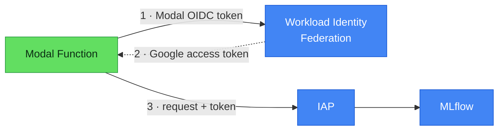
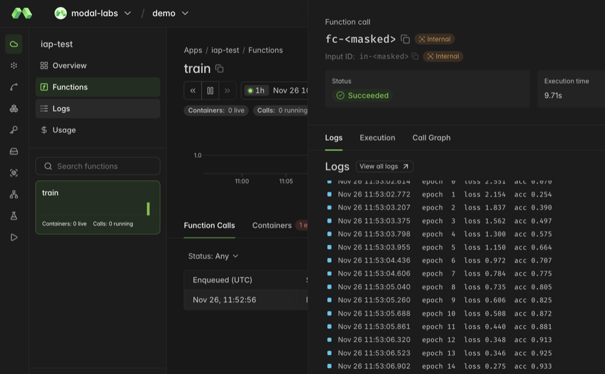
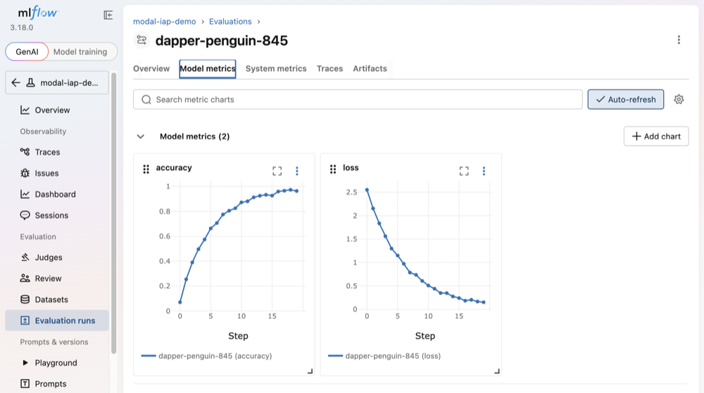

# Modal → Google Cloud IAP

Call a service behind Google Cloud [Identity-Aware Proxy](https://cloud.google.com/iap/docs/concepts-overview) from a Modal Function, with no service account keys. This example logs training metrics to an MLflow server, but the same approach works for any HTTP service behind IAP.



1. Modal gives every container a short-lived [OIDC token](https://modal.com/docs/guide/oidc-integration).
2. GCP [Workload Identity Federation](https://cloud.google.com/iam/docs/workload-identity-federation) trusts that token, for one specific Modal Function only, and swaps it for a service account's access token.
3. IAP lets the service account through. A small [MLflow auth plugin](https://mlflow.org/docs/latest/ml/plugins/#authentication-plugins) adds the token to every request and refreshes it automatically.

<p>
  
  
</p>

## Try it

**1. Set up GCP.** These commands create a Workload Identity pool, a service account, and an MLflow server on Cloud Run behind IAP.

<details>
<summary>GCP setup commands</summary>

```bash
PROJECT_ID=my-project
PROJECT_NUMBER=$(gcloud projects describe $PROJECT_ID --format='value(projectNumber)')
REGION=europe-west1
MODAL_FUNCTION=ac-xxxx:main:iap-test:train   # workspace_id:environment:app:function
SA=iap-test-caller@$PROJECT_ID.iam.gserviceaccount.com
POOL=projects/$PROJECT_NUMBER/locations/global/workloadIdentityPools/iap-test-modal-pool
gcloud config set project $PROJECT_ID

gcloud services enable run.googleapis.com iap.googleapis.com sts.googleapis.com \
  iamcredentials.googleapis.com cloudresourcemanager.googleapis.com \
  cloudbuild.googleapis.com artifactregistry.googleapis.com

# Trust Modal tokens from your workspace
gcloud iam workload-identity-pools create iap-test-modal-pool --location=global
gcloud iam workload-identity-pools providers create-oidc modal \
  --location=global --workload-identity-pool=iap-test-modal-pool \
  --issuer-uri=https://oidc.modal.com --allowed-audiences=oidc.modal.com \
  --attribute-mapping="google.subject=assertion.function_id,attribute.function=assertion.workspace_id + ':' + assertion.environment_name + ':' + assertion.app_name + ':' + assertion.function_name" \
  --attribute-condition="assertion.workspace_id == '${MODAL_FUNCTION%%:*}'"

# A service account only that one Modal Function can use
gcloud iam service-accounts create iap-test-caller
gcloud iam service-accounts add-iam-policy-binding $SA --role=roles/iam.workloadIdentityUser \
  --member="principalSet://iam.googleapis.com/$POOL/attribute.function/$MODAL_FUNCTION"

# MLflow on Cloud Run behind IAP, open to that service account
gcloud run deploy iap-test-mlflow --source mlflow_server --region=$REGION \
  --no-allow-unauthenticated --iap --memory=2Gi --max-instances=1 \
  --set-env-vars=MLFLOW_HOST=iap-test-mlflow-$PROJECT_NUMBER.$REGION.run.app
gcloud iap web add-iam-policy-binding --resource-type=cloud-run --service=iap-test-mlflow \
  --region=$REGION --member=serviceAccount:$SA --role=roles/iap.httpsResourceAccessor
```

To open MLflow in your browser, run the last command again with `--member=user:you@example.com`.

</details>

**2. Configure.** Store your settings in a Modal Secret:

```bash
modal secret create iap-test \
  WIF_PROVIDER=$POOL/providers/modal \
  SERVICE_ACCOUNT=$SA \
  MLFLOW_URL=https://iap-test-mlflow-$PROJECT_NUMBER.$REGION.run.app
```

**3. Run.**

```bash
modal run modal_app.py
```

## Good to know

- **Permission changes take a few minutes** to apply. A `403` right after setup usually fixes itself.
- **Access is tied to names.** Renaming the environment, app or function means updating the grant.
- **Modal's `sub` claim is too long for GCP** (over 127 bytes), so the setup uses `function_id` as the subject.
- **The demo MLflow server stores data on local disk**, so runs disappear when Cloud Run scales it down.
